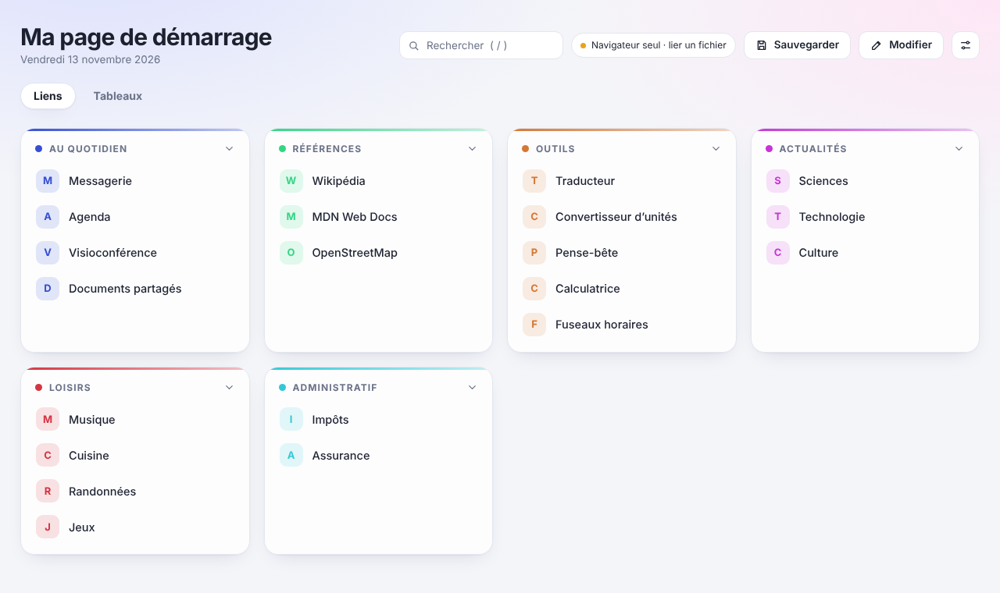
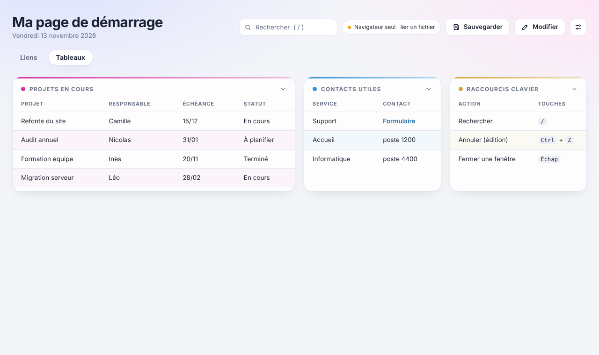
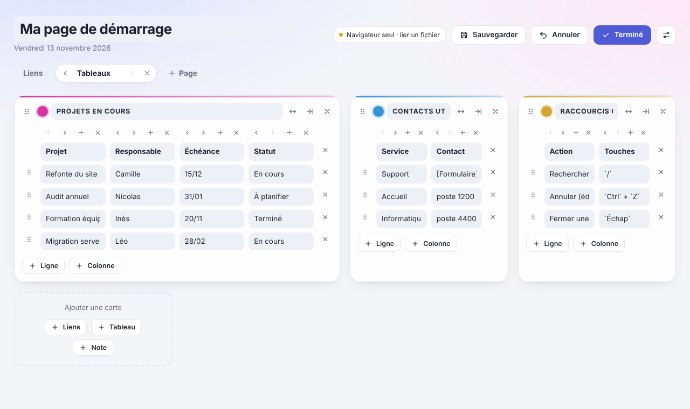
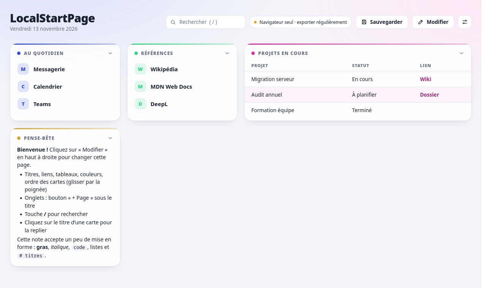
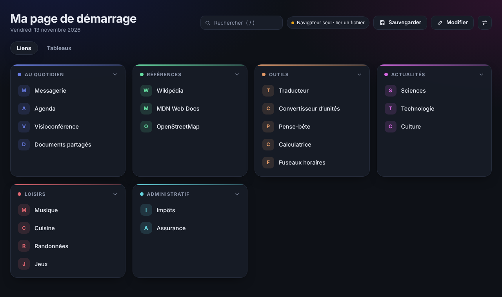

# LocalStartPage

Page personnelle de liens et de notes, **dans un seul fichier HTML**. Pas d'installation, pas de serveur, pas de compte, pas de droits administrateur : on ouvre le fichier et c'est prêt. Tout se modifie à la souris, sans écrire de HTML.

Elle s'utilise comme **page de démarrage**, comme **index** de vos sites, outils et documents, ou comme **favoris enrichis** : chaque onglet peut regrouper les liens d'un thème (un projet, un service, un loisir…) avec, juste à côté, le contexte utile et les informations à ne pas oublier.

## Points forts

- **Un seul fichier**, aucune dépendance, **aucune connexion réseau** : le code ne contient ni appel serveur, ni script ou feuille de style externe. Rien ne quitte votre ordinateur.
- **Trois types de cartes** : liens, tableaux, notes (avec un peu de Markdown).
- **Des liens avec leur contexte** : un tableau place chaque lien à côté de ce qui l'explique (responsable, échéance, statut, identifiant…) ; une note garde les informations importantes (procédure, rappel, numéro utile) sur l'onglet où l'on en a besoin. Voir [Liens, contexte et notes](#liens-contexte-et-notes).
- **Plusieurs pages** (onglets) par thème, et recherche instantanée sur toutes les pages, tableaux et notes compris.
- **Édition directe** : titres, liens, couleurs, ordre des cartes, lignes et colonnes des tableaux, tout se déplace par glisser-déposer ou avec de petits boutons.
- **Pensé pour ne pas perdre ses données** : enregistrement automatique, historique des versions, annulation, fichier de sauvegarde lié avec détection de conflit, bouton « Sauvegarder » et rappel.
- **Import et export des favoris** du navigateur, avec prévisualisation avant import.
- **Thème automatique, clair ou sombre** (l'automatique suit le réglage du système), trois dispositions de cartes au choix.

| Tableaux | Mode édition |
|---|---|
|  |  |

| Premier lancement (note d'accueil) | Thème sombre |
|---|---|
|  |  |

## Démarrage rapide

1. Téléchargez `LocalStartPage.html` (bouton « Download raw file » sur GitHub, ou la page « Releases »).
2. Placez-le dans un dossier de votre choix et **ouvrez-le avec votre navigateur** (double-clic, ou « Ouvrir avec »).
3. Cliquez sur **Modifier** en haut à droite pour changer la page.
4. Pour l'ouvrir au démarrage du navigateur ou à chaque nouvel onglet, voir [En faire sa page de démarrage](#en-faire-sa-page-de-démarrage) : tous les navigateurs ne l'acceptent pas sans extension. Sinon, un simple favori vers le fichier suffit.
5. Pensez à **sauvegarder** (voir plus bas) : vos données sont dans le navigateur, pas dans le fichier.

Pour essayer avec des données d'exemple : *Réglages → Importer* puis choisissez `exemples/LocalStartPage-exemple.json`.

## En faire sa page de démarrage

L'adresse de la page est celle du fichier (par exemple `file:///C:/Users/vous/Documents/LocalStartPage.html`) : ouvrez le fichier et copiez l'adresse affichée.

Pour l'ouvrir au démarrage ou dans chaque nouvel onglet, tout dépend du navigateur : certains acceptent une page locale dans leurs réglages, d'autres la refusent ou demandent une extension de redirection des nouveaux onglets (à titre indicatif : [New Tab Redirect](https://github.com/jimschubert/newtab-redirect) ou [Custom New Tab URL](https://chromewebstore.google.com/detail/custom-new-tab-url/mmjbdbjnoablegbkcklggeknkfcjkjia) pour les navigateurs Chromium, [New Tab Override](https://addons.mozilla.org/firefox/addon/new-tab-override/) pour Firefox ; non testées avec LocalStartPage). Consultez l'aide de votre navigateur.

Dans tous les cas, un favori vers le fichier dans la barre de favoris fonctionne partout.

## Utilisation

### Liens, contexte et notes
Une carte de liens suffit pour des favoris. Quand un lien ne parle pas de lui-même, les deux autres types de cartes ajoutent le contexte :

- **Tableau** : chaque ligne associe un lien à ses informations. Par exemple un tableau « Projets » avec les colonnes Projet, Responsable, Échéance, Statut et un lien `[Dossier](https://…)` vers les documents, ou un tableau « Contacts » qui pointe vers le bon formulaire. Une cellule accepte le texte, la mise en forme et les liens.
- **Note** : les informations à garder sous les yeux, propres au thème de l'onglet (procédure à suivre, rappel, identifiants de dossier, numéros utiles). Une note peut elle aussi contenir des liens.

Comme chaque onglet regroupe un thème, liens, tableaux et notes de ce thème restent ensemble. La recherche (`/`) porte sur tout ce contenu, sur toutes les pages.

### Cartes
En mode **Modifier**, le bouton « Ajouter une carte » propose trois types :

- **Liens** : un nom et une adresse. Les adresses sans `https://` sont complétées, les chemins Windows (`C:\…` ou `\\serveur\…`) sont convertis.
- **Tableau** : lignes et colonnes libres. La première ligne sert d'en-tête. Vous pouvez ajouter une colonne avant ou après une colonne donnée, la déplacer à gauche ou à droite, et réordonner les lignes par glisser-déposer.
- **Note** : texte libre avec un mini-Markdown.

Chaque carte a une couleur (12 teintes), une largeur (normale ou double) et peut être repliée en cliquant sur son titre. Une nouvelle carte reçoit la couleur la moins utilisée de la page.

### Mise en forme du texte
Dans les notes et les cellules de tableau :

| Écrire | Résultat |
|---|---|
| `**gras**` | **gras** |
| `*italique*` | *italique* |
| `` `code` `` | `code` |
| `[texte](https://exemple.fr)` | un lien |
| une adresse `https://…` seule | un lien |

Dans les notes seulement : `# Titre`, `## Sous-titre`, `- liste`, `1. liste numérotée`, `> citation`, `---` (séparateur).

### Pages (onglets)
Le bouton « + Page » apparaît en mode Modifier. Une page se renomme, se déplace et se supprime. Une carte peut être déplacée vers une autre page par son menu, ou en la glissant sur l'onglet.

### Recherche
Touche **`/`** (ou `Ctrl` + `K`) pour chercher. La recherche ignore la casse et les accents, et porte sur **toutes les pages** : les résultats sont groupés par page, la page courante en premier. `Entrée` ouvre le premier lien trouvé, `Échap` efface la recherche.

### Thème
Dans *Réglages → Apparence* :

- **Auto** (par défaut) : suit le thème clair ou sombre du système, et bascule tout seul quand il change.
- **Clair** ou **Sombre** : thème fixe, quel que soit le réglage du système.

### Dispositions
Dans *Réglages → Apparence* :

- **Lignes** (par défaut) : cartes en rangées de même hauteur, dans l'ordre de la liste.
- **Ordonnée** : même ordre, chaque carte garde sa hauteur (des vides peuvent rester).
- **Compacte** : les cartes suivantes remontent pour combler les vides ; l'ordre à l'écran peut alors différer de la liste.

### Annuler
En mode Modifier, le bouton **Annuler** (ou `Ctrl` + `Z` hors champ de saisie) revient en arrière sur les 60 dernières modifications.

## Vos données et leur sauvegarde

> **À retenir** : le fichier HTML ne contient que le programme. Vos données sont stockées **dans le navigateur**. Si le navigateur efface ses données (certaines politiques d'entreprise le font à la fermeture), elles disparaissent. Sauvegardez.

LocalStartPage propose plusieurs niveaux de protection :

1. **Enregistrement automatique** dans le navigateur à chaque modification.
2. **Historique** : les 15 dernières versions sont conservées et restaurables (*Réglages → Historique automatique*). Toute opération risquée (import, restauration, remplacement par un fichier) conserve d'abord l'ancienne version.
3. **Fichier lié** (Edge, Chrome, Brave avec option) : *Réglages → Créer le fichier de sauvegarde* ou *Lier un fichier existant*. Chaque modification y est recopiée. Si le fichier a changé ailleurs (autre navigateur, autre poste), la page le détecte, **n'écrase rien** et vous laisse choisir la version à garder.
4. **Bouton « Sauvegarder »** en haut : enregistre à la demande dans le fichier lié, dans un fichier choisi une fois, ou par téléchargement si le navigateur ne le permet pas. Il demande confirmation avant d'écraser un fichier modifié entre-temps.
5. **Rappel** si la dernière sauvegarde est ancienne (3, 7, 14 ou 30 jours, ou jamais, au choix).
6. **Export / import JSON** à la main (*Exporter (télécharger)* / *Importer*).

### Compatibilité du fichier lié

| Navigateur | Fichier lié |
|---|---|
| Edge, Chrome | oui |
| Brave | oui, après avoir activé l'option « File System Access API » dans `brave://flags` |
| Firefox | non (utilisez l'export JSON ou le bouton « Sauvegarder », qui télécharge un fichier) |

La page fonctionne sans fichier lié sur tous les navigateurs récents ; seule la recopie automatique dans un fichier en dépend.

## Plusieurs pages indépendantes

Les données sont rangées **sous le nom du fichier** : `LocalStartPage.html` et `travail.html` ont chacun leurs propres données. Pour avoir deux pages séparées, copiez simplement le fichier sous un autre nom.

- Les noms proposés pour les sauvegardes et les exports reprennent ce nom (`travail-data.json`, `travail-backup-2026-11-13.json`, `travail-bookmark-2026-11-13.html`).
- Le titre par défaut d'une nouvelle page est ce nom.
- **Deux fichiers de même nom, même dans des dossiers différents, partagent les mêmes données.**
- **Renommer le fichier** revient à ouvrir une page vide : vos données restent sous l'ancien nom, vous pouvez les récupérer avec un import.
- *Réglages → Pages enregistrées dans ce navigateur* liste tous les noms trouvés et permet de supprimer les données de chacun (définitif : exportez avant).
- Remplacer le fichier par une nouvelle version, sans changer son nom, **ne fait rien perdre**.

## Favoris du navigateur

*Réglages → Favoris du navigateur* :

- **Importer** un export de favoris (HTML, format commun à Edge, Chrome, Brave et Firefox). Une prévisualisation permet de cocher ce qui est importé, de renommer les pages et les cartes, et de repérer les doublons. Les dossiers de premier niveau deviennent des pages et chaque dossier contenant des liens devient une carte, nommée « Parent › Enfant » pour les sous-dossiers.
- **Exporter** les liens de la page au format HTML pour les réimporter dans un navigateur. Seuls les liens sont exportés (pas les tableaux ni les notes).

## Limites connues

- Les données restent dans **un navigateur sur un poste** : pas de synchronisation automatique entre appareils. Le fichier lié permet de les transporter à la main.
- Pas de fichier lié sur Firefox.
- Page de démarrage ou de nouvel onglet : dépend du navigateur (voir [En faire sa page de démarrage](#en-faire-sa-page-de-démarrage)).
- Le glisser-déposer de favoris depuis la barre du navigateur vers la page n'est pas géré (les navigateurs se comportent différemment) ; utilisez l'import de favoris.
- Développé et testé surtout sur les navigateurs Chromium (Edge, Chrome, Brave) ; Firefox est utilisable mais moins éprouvé.
- Les textes de l'interface sont en français uniquement.

## Licence

[MIT](LICENSE) © 2026 flyperic
